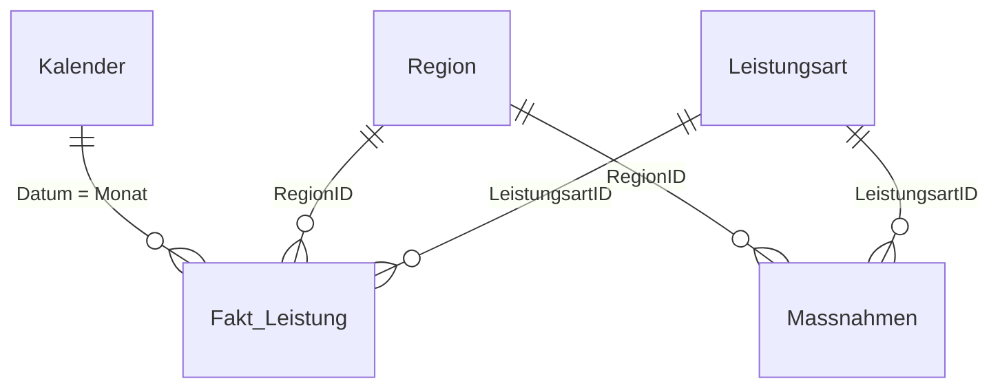

# L04 · Dokumentation aus TMDL mit Copilot

> **Wofür:** Eine Modelldokumentation, die aus den tatsächlichen Metadaten entsteht, fachlich lesbar ist und mit dem Modell
> aktuell bleibt. **Für wen:** Data Analysts, die Modelle übergeben, prüfen lassen oder Fachanwendern erklären. **Bezug:**
> vertieft Modul 1 (Ü1.9, Ü1.11). Einzelprompts: [M1-10](../prompts/modul1/M1-10_Modell-dokumentieren.md) (Modell),
> [M1-11](../prompts/modul1/M1-11_Bericht-dokumentieren.md) (Bericht), [M1-12](../prompts/modul1/M1-12_Beschreibungen-als-TMDL.md)
> (Beschreibungen zurückschreiben). TMDL und sicheres Zurückschreiben: [L03](L03_TMDL.md), [K03](../prompts/kontext/K03_TMDL-Kurzreferenz.md).

## Auf einen Blick

1. **Doku aus Metadaten, nicht aus dem Gedächtnis:** TMDL oder INFO.VIEW-Abfragen sind die Quelle.
2. **Listen kommen aus dem Modell, Copilot schreibt den Text.** Vollständigkeit prüfen Sie durch Zählen.
3. **Eine feste Vorlage** im Copilot Notebook – jede Modelldoku hat dieselbe Gliederung.
4. **Abschnitt für Abschnitt** erzeugen, nicht die ganze Doku in einem Prompt.
5. **Fachliche Bedeutung** stammt aus Glossar oder Beschreibung; alles andere markiert Copilot als „(abgeleitet)“ oder „unklar“.
6. **Zwei Fassungen:** technisch für Entwickler, verständlich für Fachanwender.
7. **Beziehungen als Mermaid-`erDiagram`:** Text, versionierbar, mit exakten Namen.
8. **Die Doku lebt im Modell:** geprüfte Definitionen als Beschreibungen zurückschreiben.
9. **Doku neben dem PBIP in Git;** jeder Modell-Diff löst eine Aktualisierung aus.
10. **Keine Daten, keine Verbindungsangaben** in den Prompt – Datenquellen fassen Sie selbst zusammen.

## Das Wichtigste kompakt

### Was in eine Modelldoku gehört

| Abschnitt | Inhalt | Quelle |
|---|---|---|
| Steckbrief | Name, Zweck, Zielgruppe, verantwortliche Rolle, Kultur, Datenstand, Aktualisierung | `model.tmdl`, `database.tmdl`, Ihr Wissen |
| Datenquellen und Partitionen | Quellsystem je Tabelle, Speichermodus (Import/DirectQuery), Aktualisierung | `partition`-Blöcke **lokal** lesen, nur zusammengefasst an Copilot |
| Tabellen | Rolle (Fakt/Dimension), „eine Zeile = …“, wichtige Spalten | TMDL bzw. Abfragen 1 und 2 |
| Beziehungen | Von/Nach, Kardinalität, Filterrichtung, aktiv; Diagramm | `relationships.tmdl` bzw. Abfrage 4 |
| Measure-Katalog | Name, fachliche Definition, Einheit, „gut ist“, Ordner, DAX | TMDL bzw. Abfrage 3 + Glossar |
| Glossar | Fachbegriffe, Abkürzungen, Synonyme | [K05](../prompts/kontext/K05_Kennzahlen-Glossar.md), Beschreibungen |
| Bekannte Einschränkungen | Was das Modell nicht oder nur bedingt richtig rechnet | Review ([M1-01](../prompts/modul1/M1-01_Modellueberblick-aus-TMDL.md)), Abfrage 6 |
| Änderungshistorie | Datum, Version, Änderung, Auswirkung auf Berichte | Git-Diff zweier TMDL-Stände |

### Ablauf in Schritten

1. **Metadaten holen.** A: TMDL ohne `partition`- und `expression`-Blöcke (im Übungsmodell nie `Daten_Fakt_Leistung` /
   `Daten_Massnahmen`). B: Abfragen 1–4 aus [`INFO_Abfragen.dax`](../uebungsdaten/modul1/INFO_Abfragen.dax) ausführen,
   Ergebnisse in `Modell-Metadaten.txt` sammeln. Die DAX-Spalte von INFO.VIEW.MEASURES ist nur mit Schreibrechten gefüllt.
2. **Quellen selbst zusammenfassen:** je Tabelle eine Zeile („Fakt_Leistung – Azure-SQL-View, Import, täglich“), ohne Server,
   Datenbanken, SQL- oder SAP-Abfragen.
3. **Notebook „Modelldoku“** mit Referenzen: Vorlage (unten, als `.txt` oder Word-Datei), K05, K03, `Modell-Metadaten.txt`.
4. **Abschnitt für Abschnitt** mit den Prompts unten erzeugen und prüfen; dann in die Vorlage übernehmen – als Word-Dokument
   (im Notebook, sofern verfügbar, über „Erstellen“) oder als `docs/Modell.md` neben dem PBIP im Repository.
5. **Prüfen:** Tabellen, Beziehungen, Measures zählen; „(abgeleitet)“-Stellen vom Fachbereich bestätigen lassen.
6. **Zurück ins Modell:** bestätigte Definitionen per [M1-12](../prompts/modul1/M1-12_Beschreibungen-als-TMDL.md) als
   Beschreibungen anwenden. Die nächste Doku liest sie über INFO.VIEW mit – Ableitungen werden mit jeder Runde weniger.

**Mit Kapazität** (F2+/P1+, Admin-Freigabe, keine Testkapazität) erzeugt Copilot in Power BI Beschreibungen einzeln aus dem
DAX (**Mit Copilot erstellen**) – ohne fachliches Wissen; der M365-Copilot-Weg mit Glossar bleibt die Grundlage.

### Doku-Vorlage (Markdown-Gerüst)

~~~markdown
# Modelldokumentation: [Modellname]
Version [x.y] · Stand [TT.MM.JJJJ] · verantwortlich: [Rolle, z. B. BI-Team Produktionscontrolling]

## 1 Steckbrief
| Merkmal | Wert |
|---|---|
| Zweck | [z. B. Monatssteuerung von Kosten, Stunden, Qualität und Maßnahmen je Region und Leistungsart] |
| Zielgruppe / Berichte | [z. B. Bereichsleitung; Bericht DBS_Produktionscontrolling] |
| Kultur / Kompatibilitätsstufe | [de-DE / 1550] |
| Datenstand / Aktualisierung | [Monatswerte bis Berichtsmonat; täglich 06:00] |

## 2 Datenquellen und Partitionen
| Tabelle | Quelle (zusammengefasst) | Speichermodus | Aktualisierung |
|---|---|---|---|

## 3 Tabellen
| Tabelle | Rolle | Eine Zeile = | Wichtige Spalten |
|---|---|---|---|

## 4 Beziehungen
| Von | Nach | Kardinalität | Filterrichtung | Aktiv |
|---|---|---|---|---|



## 5 Measure-Katalog
| Measure | Fachliche Definition | Einheit | Gut ist | Ordner | DAX (Kurzform) |
|---|---|---|---|---|---|

## 6 Glossar
| Begriff | Bedeutung | Synonyme |
|---|---|---|

## 7 Bekannte Einschränkungen
- [z. B. Massnahmen hat keine Beziehung zum Kalender: Maßnahmen-Kennzahlen reagieren nicht auf den Monatsfilter.]

## 8 Änderungshistorie
| Datum | Version | Änderung | Auswirkung auf Berichte |
|---|---|---|---|

## Annahmen und offene Punkte
~~~

### Große Modelle in Etappen

1. **Gerüst:** Steckbrief, Tabellen, Beziehungen aus dem Inventar (Abfragen 1, 2, 4) – klein und vollständig.
2. **Measures je Anzeigeordner** oder Tabelle, 30–50 je Prompt, jeden Teil kennzeichnen („Teil 3 von 6, Ordner Kosten“).
3. **Glossar und Einschränkungen** aus den fertigen Teilen, nicht aus dem Roh-TMDL. Nach jeder Etappe zählen.

### Doku aktuell halten

- **PBIP in Git, Doku im selben Repository:** Ein Commit, der das Modell ändert, ändert auch `docs/Modell.md`.
- **Diff als Auslöser:** vor jeder Veröffentlichung den Diff seit der letzten Doku-Version erzeugen, Änderungsvermerk (Aufgabe 6).
- **INFO-Abfragen als gespeicherte Registerkarte** der DAX-Abfrageansicht (im PBIP: Ordner `DAXQueries`) – reproduzierbar.
- **Beschreibungen im Modell** sind der Teil der Doku, den Copilot in Power BI, Agenten und Berichtsersteller direkt sehen.

### Grenzen

Copilot erfindet fachliche Bedeutung, wenn sie nirgends steht: Aus `m_QQ` wird schnell eine „Mengenquote“. Deshalb in jedem
Prompt: Bedeutung nur aus Beschreibung oder Glossar, sonst „(abgeleitet)“ oder „unklar“, und Annahmen am Ende auflisten.
Copilot sieht weder Daten noch Visuals (dafür [M1-11](../prompts/modul1/M1-11_Bericht-dokumentieren.md)) und kann nicht
beurteilen, ob ein Measure im Bericht richtig verwendet wird. Die fachliche Freigabe bleibt beim Fachbereich.

### Ausblick: vollautomatisierte Doku in Fabric (Termin 2, Modul 4)

Liegt das Modell in einem Fabric-Arbeitsbereich, liest ein Fabric-Notebook die Metadaten direkt aus dem Modell (Semantic
Link), erzeugt Tabellen, Beziehungsdiagramm und Measure-Katalog und legt sie im Repository oder Lakehouse ab – angestoßen
über Git oder einen Zeitplan; Copilot ergänzt nur noch Text. Vorlage, Glossar und Beschreibungen im Modell sind die Grundlage dafür.

## Mit Copilot arbeiten

Im Notebook „Modelldoku“ gilt für alle Prompts: Bedeutung nur aus Beschreibung oder Glossar, sonst „(abgeleitet)“ bzw.
„unklar – bitte ergänzen“; am Ende „Annahmen und offene Punkte“.

### Aufgabe 1 · Steckbrief

**Wann:** zu Beginn jeder Doku, auch als Kurzinfo für eine Übergabe.

```text
Du bist technischer Redakteur für Power-BI-Modelle. Fülle Abschnitt 1 "Steckbrief" der Vorlage.
Kontext: model.tmdl und database.tmdl [EINFÜGEN], Tabellenliste aus Abfrage 1 [EINFÜGEN],
meine Angaben [EINFÜGEN: Zweck, Zielgruppe, Berichte, Aktualisierung, verantwortliche Rolle].
Regeln: Technische Werte (Kultur, Kompatibilitätsstufe, Speichermodus) nur aus dem Kontext. Fehlt eine Angabe: "[offen]".
Ausgabe: Markdown-Tabelle wie in der Vorlage, danach 3 Sätze "Worum geht es in diesem Modell?".
```

**Ergebnis prüfen**
- [ ] Kultur und Kompatibilitätsstufe stehen so im TMDL (Übungsmodell: `de-DE`, `1550`).
- [ ] Keine erfundenen Aktualisierungszeiten oder Quellsysteme – nur Ihre Angaben oder „[offen]“.

### Aufgabe 2 · Measure-Katalog als Tabelle

**Wann:** Kern jeder Modelldoku; bei großen Modellen je Anzeigeordner wiederholen.

```text
Du bist technischer Redakteur. Fülle Abschnitt 5 "Measure-Katalog" der Vorlage.
Kontext: Measures als TMDL bzw. Abfrage 3 [EINFÜGEN: Teil X von Y, Ordner/Tabelle], Glossar K05.
Aufgabe: Je Measure eine Zeile: fachliche Definition (1 Satz), Einheit, "gut ist", Ordner, DAX-Kurzform (erste Zeile,
wörtlich). Sortiere nach Ordner, dann Name.
Regeln: Jedes Measure aus dem Kontext genau einmal, keines zusätzlich. DAX nicht verbessern. Auffälligkeiten (Division
mit "/", Zeitintelligenz auf einer Faktspalte) als Fußnote, nicht in der Definition.
Ausgabe: Markdown-Tabelle, danach "Anzahl Measures: n" und Annahmen.
```

**Ergebnis prüfen**
- [ ] Anzahl = Zeilen von Abfrage 3 (Übungsmodell: 18); DAX-Kurzformen per Strg+F im TMDL auffindbar.
- [ ] `m_QQ`, `KPI Status Text`, `Produktivitaet` entsprechen dem Glossar, nicht einer Vermutung.

### Aufgabe 3 · Beziehungsdiagramm als Mermaid-`erDiagram`

**Wann:** für Abschnitt 4 und für jede Übergabe – ein Bild sagt hier mehr als die Tabelle.

```text
Erstelle aus diesen Beziehungen [EINFÜGEN: relationships.tmdl oder Abfrage 4]:
1. die Tabelle für Abschnitt 4 der Vorlage (Von | Nach | Kardinalität | Filterrichtung | Aktiv);
2. ein Mermaid-erDiagram in einem ```mermaid-Block: Seite "eins" links (||), Seite "viele" rechts (o{),
   Beschriftung = verknüpfte Spalte(n), inaktive Beziehungen gestrichelt (..).
Regeln: Exakt die Namen aus dem Kontext; Leerzeichen in Namen durch Unterstrich ersetzen und das in einer Fußnote nennen.
Keine Beziehungen oder Tabellen erfinden.
```

**Ergebnis prüfen**
- [ ] Anzahl Linien = Zeilen von Abfrage 4 (Übungsmodell: 5); Richtung „eins/viele“ stimmt.
- [ ] Diagramm rendert in einem Mermaid-fähigen Viewer (z. B. VS Code mit Mermaid-Erweiterung, Repository-Ansicht).

### Aufgabe 4 · Glossar

**Wann:** Kennzahlen, Abkürzungen und Fachbegriffe müssen für Leser außerhalb des BI-Teams erklärt werden.

```text
Erstelle Abschnitt 6 "Glossar" aus dem fertigen Measure-Katalog [EINFÜGEN] und dem Glossar K05.
Aufgabe: Alle Fachbegriffe und Abkürzungen aus Measure-, Spalten- und Ordnernamen (z. B. Abw, VJ, YTD, QQ, Leistungsart,
Geschäftsfeld), je mit Bedeutung in einem Satz und 1–3 Synonymen, wie Fachleute danach fragen.
Regeln: Bedeutungen aus K05 übernehmen; was dort fehlt, als "(abgeleitet)" kennzeichnen. Alphabetisch sortieren.
```

**Ergebnis prüfen**
- [ ] Jede Abkürzung aus den Measure-Namen kommt vor (`Abw`, `VJ`, `YTD`, `QQ`).
- [ ] Synonyme sind realistisch; die Liste taugt auch für AI-Instructions ([M1-13](../prompts/modul1/M1-13_Modell-KI-faehig-machen.md)).

### Aufgabe 5 · Fassung für Fachanwender

**Wann:** Die technische Doku ist geprüft; Berichtsnutzer brauchen eine Seite ohne DAX.

```text
Erstelle aus der geprüften Modelldoku [EINFÜGEN oder "siehe Notebook"] eine Fassung für Fachanwender (höchstens 2 Seiten):
Kennzahlen nach Themen (Kosten, Personal, Qualität, Maßnahmen) mit je einem Satz Bedeutung, Einheit und "gut ist";
Zeitlogik (Berichtsmonat, Vorjahr, YTD); 5 Lesehinweise; bekannte Einschränkungen in Alltagssprache.
Regeln: Keine DAX-Funktionen, keine ID-Spalten, nichts, was nicht in der Doku steht. Namen so, wie Nutzer sie im Bericht sehen.
```

**Ergebnis prüfen**
- [ ] Stichprobe von fünf Sätzen: jede Aussage steht in der technischen Doku; ein Fachanwender hat gegengelesen.
- [ ] Schwellen und Richtungen stimmen (Krankenquote über 8 % beobachten, Qualitätsquote Ziel ≥ 90 %).

### Aufgabe 6 · Änderungsvermerk aus dem Git-Diff zweier TMDL-Stände

**Wann:** vor jeder Veröffentlichung einer neuen Modellversion; Abschnitt 8 der Doku. Diff erzeugen im Ordner mit dem PBIP
(`v1.0` = Tag oder Commit der letzten Doku-Version; Datenausdrücke ausgeschlossen):

```text
git diff v1.0 HEAD --output=Modell-Diff.txt -- "DBS_Produktionscontrolling.SemanticModel/definition" ":(exclude)DBS_Produktionscontrolling.SemanticModel/definition/expressions.tmdl"
```

Ohne Git: zwei PBIP-Kopien in VS Code vergleichen. Vorher Server- und Datenbanknamen aus geänderten `partition`-Blöcken entfernen.

```text
Du bist Release-Verantwortlicher für ein Power-BI-Modell. Unten steht der Diff der TMDL-Dateien zwischen Version
[EINFÜGEN: alt] und [EINFÜGEN: neu]: [EINFÜGEN: Diff oder Anhang Modell-Diff.txt]
Aufgabe: Schreibe den Änderungsvermerk für Abschnitt 8: neue, geänderte, gelöschte Objekte (Measures, Spalten, Beziehungen,
Eigenschaften), je mit Auswirkung auf Berichte (z. B. "Visuals mit [m_QQ] prüfen", "Werte von Kosten YTD ändern sich").
Regeln: Reine Metadaten-Änderungen (lineageTag, annotation, Reihenfolge) nur als Sammelzeile. Jede Aussage mit der Diff-Zeile
belegen. Gelöschte oder umbenannte Objekte zuerst und fett.
Ausgabe: Tabellenzeile(n) Datum | Version | Änderung | Auswirkung, danach eine Liste "Belege".
```

**Ergebnis prüfen**
- [ ] Jede Änderung hat einen Beleg im Diff; nichts aus dem Gedächtnis ergänzt.
- [ ] Gelöschte Objekte vollständig – Gegenprobe: Diff-Zeilen mit `-` am Anfang und `measure` oder `column`.
- [ ] Logikänderungen (z. B. `Kosten YTD` auf `Kalender[Datum]`) sind als „Werte ändern sich“ markiert.

## Häufige Fehler

| Symptom | Ursache | Lösung |
|---|---|---|
| Doku enthält Measures oder Tabellen, die es nicht gibt | Teilweise Eingabe, Copilot „vervollständigt“ | Teile kennzeichnen, Regel „genau einmal, keines zusätzlich“, zählen |
| Measures fehlen in der Doku | Eingabe abgeschnitten (z. B. durch Daten in `expression`-Blöcken) | Ausdrücke und Partitionen weglassen, in Etappen arbeiten |
| Definitionen klingen plausibel, sind aber falsch | Bedeutung aus dem Namen geraten | Glossar mitgeben, „(abgeleitet)“ erzwingen, Fachbereich prüft |
| DAX-Spalte leer, Copilot rät die Logik | INFO.VIEW bei Liveverbindung ohne Schreibrechte | Lokal in Desktop abfragen oder TMDL verwenden |
| Mermaid-Diagramm wird nicht gezeichnet | Leer- oder Sonderzeichen in Namen, falsche Kardinalitätszeichen | Namen mit Unterstrich, Zeichen wie in der Vorlage, im Viewer testen |
| Server- oder Datenbanknamen in der Doku | Partitionen bzw. Diff ungefiltert übergeben | Quellen selbst zusammenfassen, Diff vorher prüfen |
| Doku veraltet nach wenigen Wochen | Einmal erzeugt, nicht an Änderungen gekoppelt | Doku im Repository, Diff als Auslöser, Beschreibungen im Modell |

## Checkliste

- [ ] Metadaten aus TMDL oder INFO.VIEW, ohne Partitionen, Ausdrücke, Daten und Verbindungsangaben
- [ ] Vorlage, Glossar und Metadaten als Referenzen im Copilot Notebook
- [ ] Abschnitte einzeln erzeugt und geprüft; Tabellen, Beziehungen, Measures gezählt
- [ ] Alle „(abgeleitet)“/„unklar“-Stellen vom Fachbereich bestätigt oder ergänzt
- [ ] Mermaid-Diagramm gerendert und gegen Abfrage 4 geprüft; Fachanwender-Fassung gegengelesen
- [ ] Bestätigte Definitionen als Beschreibungen ins Modell zurückgeschrieben (M1-12)
- [ ] Doku neben dem PBIP im Repository, Version und Stand im Kopf, Änderungsvermerk aus dem Diff ergänzt

## Weiterführend

Microsoft Learn, geprüft am 18.11.2026:

- INFO-Funktionen in DAX (inkl. INFO.VIEW): https://learn.microsoft.com/dax/info-functions-dax
- INFO.VIEW.MEASURES (Hinweis zu Schreibrechten): https://learn.microsoft.com/dax/info-view-measures-function-dax
- DAX-Abfrageansicht: https://learn.microsoft.com/power-bi/transform-model/dax-query-view
- Power BI-Projekte (PBIP) und Git: https://learn.microsoft.com/power-bi/developer/projects/projects-overview
- Ordner des semantischen Modells (u. a. `DAXQueries`): https://learn.microsoft.com/power-bi/developer/projects/projects-dataset
- Copilot in Power BI Desktop (Voraussetzungen): https://learn.microsoft.com/power-bi/create-reports/copilot-power-bi-desktop
- Ausblick Fabric – Semantic Link: https://learn.microsoft.com/fabric/data-science/semantic-link-power-bi
